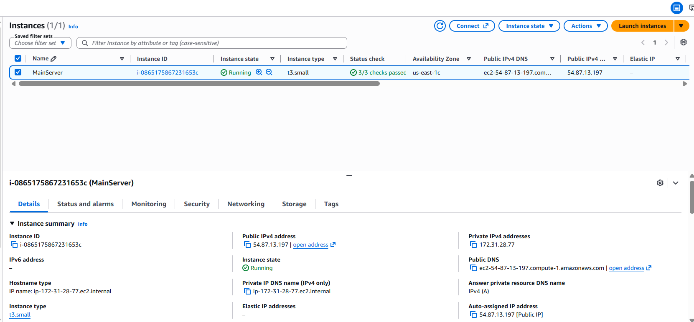
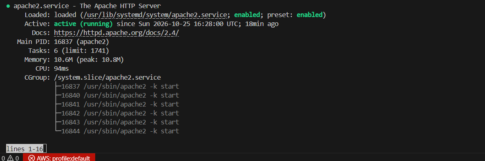
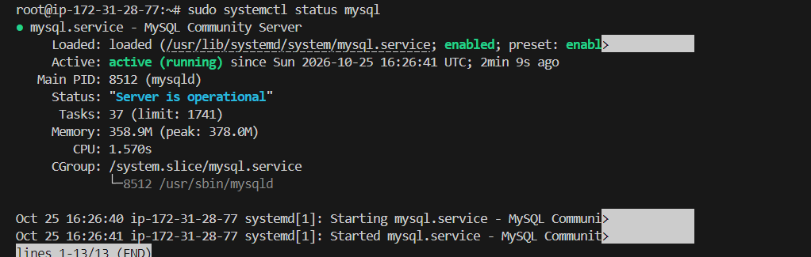
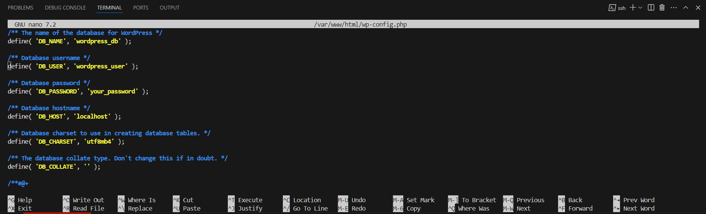
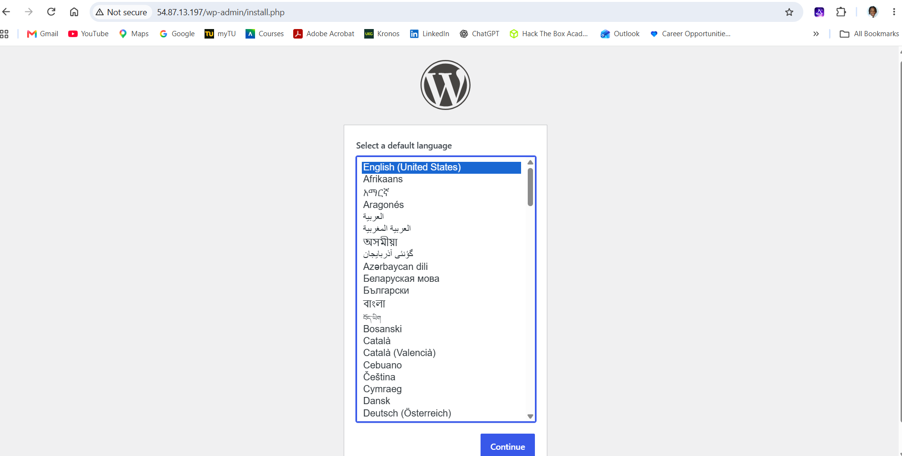
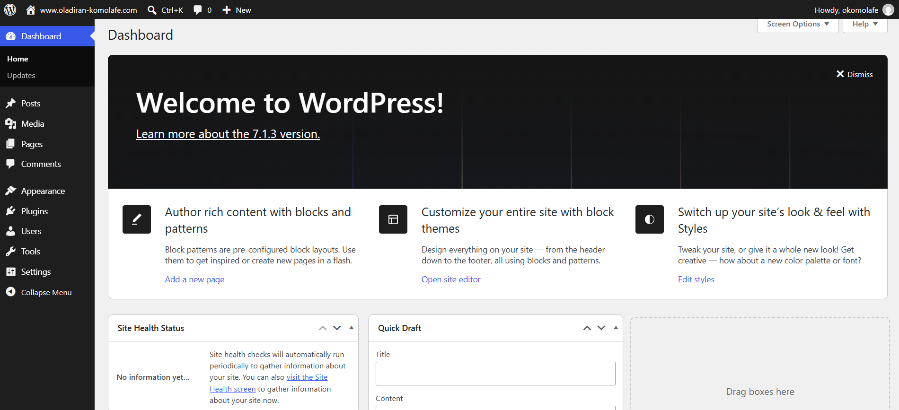
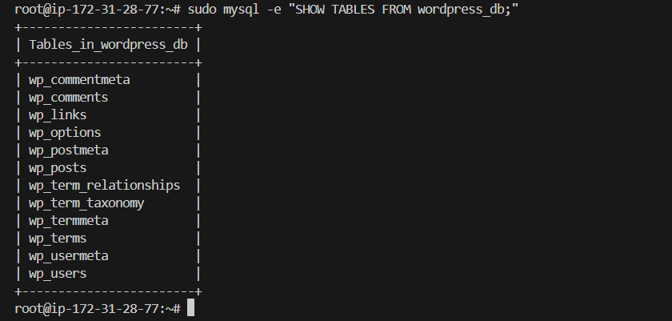
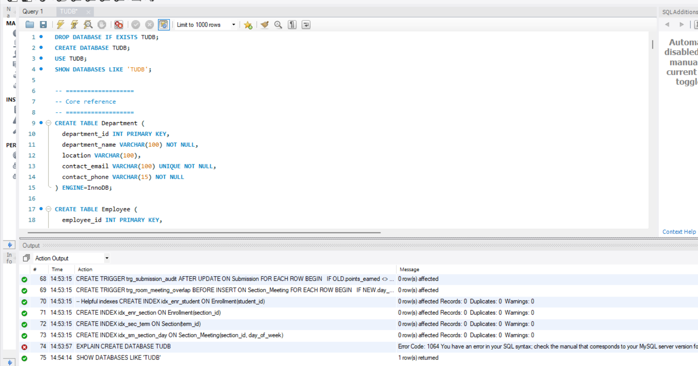

# AWS-Application-and-Database-Cloud-Migration Project

## Overview
This repository documents hands-on cloud engineering projects completed using AWS. The projects demonstrate migrating the WordPress application and a MySQL database from a local Windows environment to an AWS-hosted Ubuntu server.

Through these projects, I practiced Linux system administration, web server configuration, database management, secure file transfers, and post-migration validation.

---

## 1. WordPress Application Deployment on AWS EC2

### Objective

Deploy a functional WordPress website on an Ubuntu EC2 instance by configuring the web server, PHP runtime, MySQL database, and application settings.

### Architecture

**AWS EC2 (Ubuntu Linux)**

- Apache — Web server
- PHP — Programming Language to execute WordPress application code
- MySQL — Stores WordPress content and configuration data
- WordPress — Content management system (CMS)


### Implementation Steps

**Step 1: Provisioned an EC2 instance:**
   
Launched an Ubuntu Server in AWS using version 24.04 ami. Also used t3.small for 2GBs of RAM.
   


**Step 2: Updated the operating system:**

Updating the package manager and the applications/security features in on the server.
   
```bash
sudo apt update && sudo apt upgrade
```
**Step 3: Installed the application stack:**
   
Configured Apache, PHP, and MySQL Server.

```bash
sudo apt install apache2 -y
sudo apt install php libapache2-mod-php php-mysql -y
sudo apt install mysql-server -y
```

**Step 4: Configured services:**

Started Apache and MySQL and enabled them to launch at system startup.

```bash
sudo systemctl start apache2
sudo systemctl start mysql
sudo systemctl enable apache2
sudo systemctl enable mysql
```

**Step 5: Check Status of Apache and mySQL**

Ensuring these applications were actively running

```bash
sudo systemctl status apache2
sudo systemctl status mysql
```




**Step 6: Secured the database:** 

Ran ```mysql_secure_installation``` and configured database access. Disabled unnecessary features, enforce authentication, and remove public access.
 
**Step 7: Installed WordPress:** 

Downloaded and extracted the WordPress application files into Apache's web directory.

```bash
wget https://wordpress.org/latest.tar.gz
tar -xvzf latest.tar.gz
```

**Step 8: Move WordPress Files to Apache Directory**

Moved the WordPress Files unto the Apache main folder where it'll be accessed my the public.

**Step 9: Configured file permissions:** 

Set ownership and permissions to give Apache read and write authorization to the WordPress files to prevent issues.

**Step 10: Created the WordPress database:**

Log into mySQL as root  and create `wordpress_db` and a dedicated MySQL user with database privileges. This user will handle the admin work in the database for WordPress.

```bash

CREATE USER 'wordpress_user'@'localhost' IDENTIFIED BY 'your_password';
GRANT ALL PRIVILEGES ON wordpress_db.* TO 'wordpress_user'@'localhost';
FLUSH PRIVILEGES;
EXIT;
```

**Step 11: Configured the application:** 

Change name of the PHP file to `wp-config.php`. Updated `wp-config.php` with the database name, username, and password.

```PHP
define('DB_NAME', 'wordpress_db');
define('DB_USER', 'wordpress_user');
define('DB_PASSWORD', 'your_password');
```



**Step 12: Restart Apache and delete the default index.html**

This allows Apache to see the changes you implemented and removes the index.html file that shows Apache works to see WordPress instead

```bash
sudo systemctl restart apache2
sudo rm /var/www/html/index.html
```

**Step 13: Launched and tested WordPress:**

Accessed the EC2 public IP address and completed the initial WordPress setup.





### Evidence

| Screenshot                            | Description                                   |
| ------------------------------------- | --------------------------------------------- |
| `screenshots/ec2-instance.png`        | Ubuntu EC2 instance running in AWS            |
| `images/apache-mysql-status.png` | Apache and MySQL service status               |
| `images/wordpress-website.png`   | WordPress site accessible through the browser |
| `images/wordpress-db.png`  | WordPress database tables in MySQL            |

### Outcome

Successfully deployed WordPress on an AWS EC2 instance and configured its application stack and MySQL database connection. This project provided practical experience of a application migrations for a website being hosted on a company's on-premise server to an EC2 instance in AWS. The benefits are flexibility, easier to manage, and an innovative solution

---

## 2. MySQL Database Migration to AWS EC2

### Objective

Simulate an on-premises-to-cloud database migration by exporting a MySQL database from a local Windows environment, transferring it securely, and importing it into MySQL running on an Ubuntu EC2 instance.

### Source and Destination

| Component        | Source         | Destination             |
| ---------------- | -------------- | ----------------------- |
| Operating system | Windows        | Ubuntu Linux            |
| Database engine  | MySQL 8.0      | MySQL Server            |
| Database name    | `TUDB`         | `towsonuni_db_migrated` |
| Environment      | Local computer | AWS EC2                 |

### Technologies Used

- Amazon EC2
- Ubuntu Linux
- MySQL 8.0
- MySQL Workbench
- `mysqldump`
- Secure Copy Protocol (SCP)
- SSH
- PowerShell and Bash

### Database Contents

The sample Towson University database contains tables related to university operations, including:

- Departments
- Employees
- Students
- Courses
- Enrollments
- Payments
- Professors
- Programs and sections

The database also includes views and other database objects defined by the source schema.

### Migration Process

#### Step 1: Prepare the source database

Created the `TUDB` schema in MySQL on Windows and populated sample records in the Department, Employee, and Student tables.



#### Step 2: Export the database

Used `mysqldump` to export the schema and its data, including supported routines, triggers, and events, into a SQL dump file.

```powershell
& "C:\Program Files\MySQL\MySQL Server 8.0\bin\mysqldump.exe" `
  -u root -p `
  --databases TUDB `
  --routines --triggers --events `
  --result-file="$env:USERPROFILE\TUDB_migration.sql"
```

#### Step 3: Transfer the dump securely

Used SCP over SSH to transfer the SQL dump from Windows to the Ubuntu EC2 instance.

```powershell
scp -i "C:\Users\<username>\okomolafe-keypair.pem" `
  "C:\Users\<username>\TUDB_migration.sql" `
  ubuntu@<EC2-PUBLIC-IP>:/home/ubuntu/
```

Replace the example username, key path, and IP address with your own environment values. Never commit private keys or credentials to GitHub.

#### Step 4: Create the destination database

Created a separate database on the EC2 instance to preserve the existing WordPress database.

```sql
CREATE DATABASE towsonuni_db_migrated;
```

#### Step 5: Prepare the SQL dump

Updated the database-selection references in a copy of the SQL dump so that the import would target `towsonuni_db_migrated`.

```bash
sed 's/`TUDB`/`towsonuni_db_migrated`/g' \
  /home/ubuntu/TUDB_migration.sql \
  > /home/ubuntu/towsonuni_migration.sql
```

Verified the database references before importing.

```bash
grep -nE '^(CREATE DATABASE|USE `)' \
  /home/ubuntu/towsonuni_migration.sql
```

#### Step 6: Import the database

Imported the prepared SQL dump into MySQL on the EC2 instance.

```bash
sudo mysql < /home/ubuntu/towsonuni_migration.sql
```

#### Step 7: Validate the migration

Listed the imported tables.

```bash
sudo mysql -e "SHOW TABLES FROM towsonuni_db_migrated;"
```

Validated sample record counts.

```bash
sudo mysql -e "
SELECT COUNT(*) AS departments
FROM towsonuni_db_migrated.department;

SELECT COUNT(*) AS employees
FROM towsonuni_db_migrated.employee;

SELECT COUNT(*) AS students
FROM towsonuni_db_migrated.student;
"
```

### Migration Results

| Validation check                      | Result     |
| ------------------------------------- | ---------- |
| Destination database created          | Successful |
| Tables and views imported             | 24 listed  |
| Department records                    | 3          |
| Employee records                      | 3          |
| Student records                       | 3          |
| Existing WordPress database preserved | Yes        |

The migration was completed successfully, and the sample record counts matched the source database.

### Evidence

Add screenshots showing the source database, export, file transfer, import, and validation.

| Screenshot                             | Description                                  |
| -------------------------------------- | -------------------------------------------- |
| `screenshots/source-database.png`      | Source `TUDB` schema in MySQL Workbench      |
| `screenshots/database-export.png`      | SQL dump creation on Windows                 |
| `screenshots/scp-transfer.png`         | Secure transfer to EC2                       |
| `screenshots/destination-tables.png`   | Tables and views in the destination database |
| `screenshots/migration-validation.png` | Record-count validation results              |

*Replace these example paths with your actual screenshot filenames.*

### Outcome

Successfully migrated a sample MySQL database from a local Windows environment to an AWS-hosted Ubuntu EC2 instance. The project demonstrated database export and import, secure file transfer, destination schema configuration, and post-migration validation while keeping the WordPress database separate.

---

## Skills Demonstrated

- AWS EC2 provisioning and administration
- Linux command-line operations
- SSH and SCP-based secure remote access and file transfer
- Apache, PHP, and WordPress configuration
- MySQL database administration
- Database export and import using `mysqldump`
- SQL schema and data migration
- Database access control and separation
- Post-migration validation and troubleshooting

## Key Takeaways

These projects provided hands-on experience with two important cloud engineering activities: deploying a web application in AWS and migrating a relational database to a cloud-hosted environment.

The WordPress project focused on configuring an application stack, while the MySQL migration project focused on moving database structures and data, preserving database objects, and verifying the results.

## Repository Structure

An example repository layout:

```text
aws-cloud-migration-projects/
├── README.md
├── wordpress-deployment/
│   ├── scripts/
│   └── screenshots/
└── mysql-database-migration/
    ├── scripts/
    ├── sql/
    └── screenshots/
```

Adapt the folders to match your actual repository contents. Do not upload private keys, passwords, database credentials, or sensitive production data.

## Disclaimer

These are educational projects using sample data and personal AWS resources. The university database contains fictional sample records and is not an official university production database.
